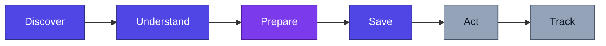
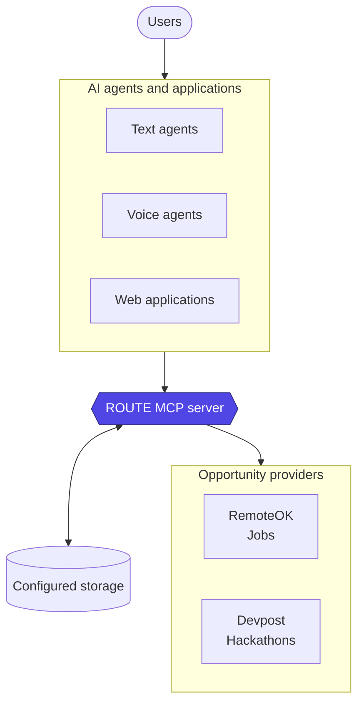

 <div align="center">

<h1>
  
</h1>

[](LICENSE)
[](https://nodejs.org)
[](https://www.typescriptlang.org)
[](https://modelcontextprotocol.io)
[](#project-status)

**An open-source, agent-agnostic Model Context Protocol (MCP) server that gives AI agents and applications a common interface for discovering, understanding, saving, and preparing for opportunities across the web.**

[Live demo](https://route-seven-eosin.vercel.app/) · [Why ROUTE](#why-route) · [Workflow](#the-opportunity-workflow) · [Architecture](#architecture) · [MCP tools](#mcp-tools) · [Providers](#providers) · [Quick start](#quick-start) · [Roadmap](#roadmap) · [Contributing](#contributing)

</div>

---

## Overview

Jobs, hackathons, and other opportunities are scattered across platforms, each with its own data structure, requirements, and discovery process. As AI agents become more capable, they need a consistent way to access those opportunities and help people pursue them.

ROUTE provides an infrastructure layer between opportunity sources and AI applications. It exposes supported sources through one MCP interface, so compatible clients do not each need to build separate integrations for every platform.

| ROUTE is                                          | ROUTE is not                                      |
| ------------------------------------------------- | ------------------------------------------------- |
| An open-source, agent-agnostic MCP server         | An AI agent tied to one ecosystem                 |
| A common interface to opportunity sources         | A job board                                       |
| Reusable infrastructure for opportunity workflows | A single website that must host every opportunity |

The current provider integrations focus on **jobs** and **hackathons**, using **RemoteOK** and **Devpost**. The architecture is designed to support additional sources and opportunity types over time.

> **The goal:** make opportunities accessible through infrastructure that developers can extend and reuse.

## Try ROUTE

- **Web demo:** [route-seven-eosin.vercel.app](https://route-seven-eosin.vercel.app/)
- **Hosted MCP endpoint:** `https://route-qu7b.onrender.com/mcp`

The web demo provides a user-facing experience for exploring opportunity workflows. The hosted MCP endpoint is intended for compatible MCP clients.

Opening the MCP endpoint directly in a browser is not a complete transport test. MCP clients communicate with it using the protocol's expected HTTP requests and headers.

## Why ROUTE?

Finding an opportunity is only the beginning. People may need to search several platforms, understand different requirements, compare options, save promising opportunities, and prepare an application or submission. Agents can help with these steps, but they need access to the underlying opportunity data.

| Without ROUTE                                            | With ROUTE                                            |
| -------------------------------------------------------- | ----------------------------------------------------- |
| Every agent builds its own integration for each platform | One MCP interface for supported sources               |
| Every platform has a different data shape                | A shared, normalized opportunity model                |
| Adding a source can require changes across clients       | A provider can be added behind the common interface   |
| Opportunity plumbing competes with the agent's core work | Developers can focus on reasoning and user experience |

## The opportunity workflow

ROUTE is organized around the stages an opportunity can go through.



| Stage          | What it means                                                                                                                                          | Status                                          |
| -------------- | ------------------------------------------------------------------------------------------------------------------------------------------------------ | ----------------------------------------------- |
| **Discover**   | Search supported sources through one interface.                                                                                                        | Implemented                                     |
| **Understand** | Retrieve structured opportunity details, such as descriptions, requirements, deadlines, and eligibility where available.                               | Implemented                                     |
| **Prepare**    | Retrieve context that a connected agent can use to help assess requirements and plan next steps. ROUTE supplies context; the agent does the reasoning. | Implemented; data completeness varies by source |
| **Save**       | Save an opportunity under a ROUTE agent identity and retrieve it later.                                                                                | Implemented                                     |
| **Act**        | Help users carry out application or submission steps.                                                                                                  | Longer-term vision                              |
| **Track**      | Follow deadlines, progress, submission status, and follow-up actions.                                                                                  | Longer-term vision                              |

**Act** and **Track** are part of the longer-term vision, not capabilities the current implementation claims to provide.

## Architecture

ROUTE is infrastructure, not the agent. Compatible agents and applications call the MCP server, which uses provider integrations to retrieve and normalize opportunity data.



| Layer                       | Responsibility                                                                             |
| --------------------------- | ------------------------------------------------------------------------------------------ |
| **Opportunity sources**     | Supply the underlying opportunity information.                                             |
| **ROUTE MCP server**        | Expose reusable tools, normalize data, and coordinate provider and persistence operations. |
| **Agents and applications** | Use ROUTE's tools to build user-facing experiences and workflows.                          |
| **Configured storage**      | Persist saved-opportunity state according to the selected storage configuration.           |

The design keeps provider-specific retrieval separate from the MCP interface. Adding a provider can make another source available to compatible clients without requiring each client to implement that source itself.

ROUTE is designed to support different agent frameworks and interfaces. Whether a particular client works depends on the protocols it supports and any adapter it needs.

## MCP tools

The hosted MCP server registers the following tools:

| Tool                      | Purpose                                                    |
| ------------------------- | ---------------------------------------------------------- |
| `health_check`            | Check whether the ROUTE MCP server is running.             |
| `search_opportunities`    | Search opportunities across supported providers.           |
| `get_opportunity`         | Retrieve an opportunity using its URL.                     |
| `prepare_opportunity`     | Retrieve preparation context for a connected agent.        |
| `save_opportunity`        | Save an opportunity for a specific ROUTE agent identity.   |
| `get_saved_opportunities` | Retrieve opportunities saved under a ROUTE agent identity. |

What each tool returns depends on the provider and the information available from the original source. A missing field does not establish that a requirement, deadline, or other detail does not exist.

### Agent identity and saved opportunities

Saved opportunities are associated with an agent identity. Clients should preserve and reuse the same `agentId` when they need to retrieve the same saved set. Using a different identity may return a different set of saved opportunities.

The persistence behavior depends on the configured storage implementation.

## Providers

ROUTE uses a provider-based architecture. Each provider retrieves information from its source and maps it into ROUTE's normalized opportunity model.

| Provider     | Category   |
| ------------ | ---------- |
| **RemoteOK** | Jobs       |
| **Devpost**  | Hackathons |

These are the initial integrations. Additional providers and categories can be added as the project grows.

### Normalized opportunity model

ROUTE maps source records into a shared structure so clients can work with different providers consistently. Depending on the source, fields can include:

| Field          | Description                                             |
| -------------- | ------------------------------------------------------- |
| `id`           | Provider-specific or normalized opportunity identifier. |
| `title`        | Opportunity title.                                      |
| `type`         | Opportunity category.                                   |
| `organization` | Company, organizer, or organization, when available.    |
| `description`  | Available description or summary.                       |
| `location`     | Location information, when available.                   |
| `remote`       | Remote-work information, when applicable.               |
| `deadline`     | Application or submission deadline, when available.     |
| `url`          | URL used to access the opportunity.                     |
| `source`       | Name of the provider supplying the opportunity.         |
| `sourceUrl`    | URL of the original source or listing, when available.  |
| `prize`        | Prize information, when applicable.                     |
| `timeline`     | Relevant dates or timeline information, when available. |
| `participants` | Participant information, when available.                |

Not every source supplies every field. Treat unavailable values as unknown rather than assuming the source has no corresponding requirement or information.

## Technology stack

| Technology          | Used for                                                   |
| ------------------- | ---------------------------------------------------------- |
| **TypeScript**      | Application and domain logic                               |
| **Node.js**         | Runtime                                                    |
| **MCP SDK**         | Exposing tools to compatible MCP clients                   |
| **Streamable HTTP** | MCP communication over HTTP                                |
| **Zod**             | Schema validation                                          |
| **Cheerio**         | HTML parsing where a provider needs it                     |
| **DynamoDB**        | Persistent storage when DynamoDB persistence is configured |

The MCP interface, opportunity services, providers, and storage are separated so each can evolve independently.

## Quick start

### Prerequisites

- Node.js 22 or later
- npm
- Git
- AWS credentials and DynamoDB configuration if you use the DynamoDB persistence implementation

### 1. Clone and install

Clone the ROUTE repository and enter the MCP server directory:

```bash
git clone <YOUR_ROUTE_REPOSITORY_URL>
cd ROUTE/mcp
npm install
```

Replace `<YOUR_ROUTE_REPOSITORY_URL>` with the actual Git clone URL for the repository.

### 2. Configure storage

For DynamoDB-backed persistence, the implementation supports table-name configuration such as:

```env
DYNAMODB_OPPORTUNITIES_TABLE=ROUTE_Opportunities
DYNAMODB_AGENT_OPPORTUNITIES_TABLE=ROUTE_AgentOpportunities
```

These are the default table names used by the storage implementation when no override is supplied. Configure AWS credentials, region, and any other required settings for your selected persistence implementation. Check the current source and environment configuration before deploying.

Never commit credentials, API keys, or other secrets to version control.

### 3. Run the MCP server locally

From the `mcp` directory:

```bash
npm run dev
```

Use the build and start scripts defined in `mcp/package.json` for a production build. Required environment variables depend on the configured storage implementation.

### 4. Connect an MCP client

Use the hosted Streamable HTTP endpoint in a compatible MCP client:

```text
https://route-qu7b.onrender.com/mcp
```

Configure the client to use **Streamable HTTP**. MCP clients negotiate the transport and send protocol messages; simply opening the endpoint in a browser is not equivalent.

For local development, use the endpoint exposed by your local server process, typically on the configured local port with `/mcp` appended.

## Project status

ROUTE is under active development. The MCP server and web demo have been deployed, but deployment does not mean every provider result is complete or that the service has completed production security hardening.

### Implemented

- [x] MCP server using Streamable HTTP
- [x] Hosted MCP endpoint
- [x] Web demo deployment
- [x] RemoteOK provider for jobs
- [x] Devpost provider for hackathons
- [x] Normalized opportunity model
- [x] Tools for searching, retrieving, preparing, saving, and listing saved opportunities
- [x] DynamoDB persistence implementation

### Ongoing work

- [ ] More complete and consistent source data, with clear handling of missing fields
- [ ] Broader automated coverage for provider and saved-opportunity workflows
- [ ] More reliable persistence and agent-scoped retrieval across deployment configurations
- [ ] Clearer setup and connection guidance for additional MCP clients

### Longer-term plans

- [ ] More opportunity providers and categories
- [ ] Richer preparation context and workflow support
- [ ] Improved user and agent state management
- [ ] Opportunity progress tracking and follow-up workflows
- [ ] Production hardening, authentication, observability, and operational safeguards
- [ ] Integrations with a wider range of agents, applications, and voice interfaces

## Roadmap

| Phase | Focus                               | What it covers                                                                                       |
| :---: | ----------------------------------- | ---------------------------------------------------------------------------------------------------- |
|   1   | **MCP foundation**                  | Core server, MCP transport, tool registration, schemas, and tests.                                   |
|   2   | **Opportunity providers**           | Provider integrations, normalized data, and searching and retrieving opportunities.                  |
|   3   | **Persistent opportunity state**    | Saving and retrieving opportunities under an agent identity with clear identity semantics.           |
|   4   | **Preparation workflows**           | Better context to help connected agents understand requirements and plan next steps.                 |
|   5   | **Production readiness**            | Reliability, security, configuration, testing, observability, and operational safeguards.            |
|   6   | **Broader agent and app ecosystem** | More agents, frameworks, applications, and interfaces, including voice integrations where supported. |

These phases describe the project's direction; they do not imply that every capability is already complete.

## Design principles

| Principle                 | What it means                                                                                       |
| ------------------------- | --------------------------------------------------------------------------------------------------- |
| **MCP first**             | MCP is the standard interface for exposing ROUTE's capabilities to compatible clients.              |
| **Agent agnostic**        | Opportunity access does not depend on a single agent, model provider, or framework.                 |
| **Opportunity first**     | Focus on the data and infrastructure opportunity workflows need.                                    |
| **Live opportunities**    | Fetch from supported sources where possible, while recognizing freshness and completeness can vary. |
| **Provider independence** | Keep source-specific retrieval and mapping separate from the core interface.                        |
| **Composable workflows**  | Expose reusable capabilities that agents can combine with their own reasoning and tools.            |
| **Small core**            | Keep the core focused on opportunity access, normalization, and shared infrastructure.              |
| **Open by default**       | Build an extensible foundation that developers can inspect, adapt, and contribute to.               |

## Who is ROUTE for?

ROUTE is for developers building:

- **AI agents** that discover and evaluate jobs or hackathons
- **Applications** that need a consistent interface to multiple opportunity sources
- **Agent workflows** that save opportunities and retrieve them later
- **Voice assistants** that explore opportunities through an MCP-compatible integration or adapter
- **Opportunity-focused products** that do not want to build every source integration themselves

The aim is to make opportunity access reusable, so developers can spend more time on the experience they want to build.

## Contributing

Contributions are welcome. Useful areas include:

- Adding opportunity providers
- Improving opportunity normalization and source-data completeness
- Expanding automated tests
- Improving MCP client compatibility
- Strengthening persistence and error handling
- Improving documentation and setup instructions
- Exploring new opportunity-focused workflows

Please read any repository-specific contribution guidelines before opening a pull request.

## License

ROUTE is released under the [MIT License](LICENSE).

<div align="center">
  <sub>Built so that opportunities are within reach of every agent.</sub>
  <br>
  <sub><a href="#readme">Back to top</a></sub>
</div>
