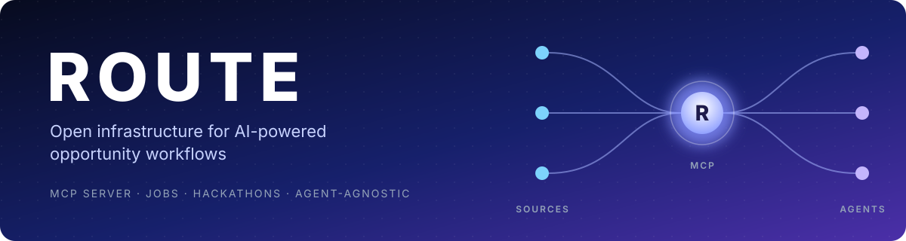
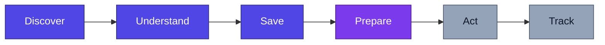
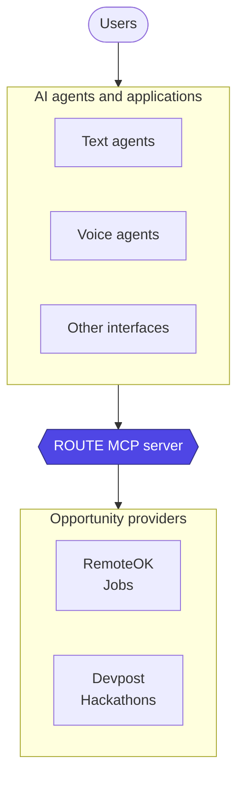
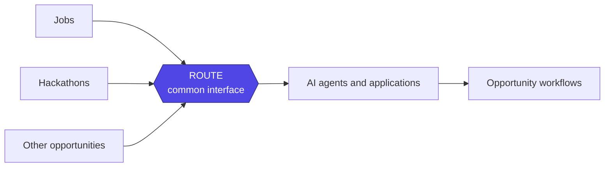

<div align="center">

<h1>
  
</h1>

[](LICENSE)
[](https://nodejs.org)
[](https://www.typescriptlang.org)
[](https://modelcontextprotocol.io)
[](#project-status)

**An open-source, agent-agnostic [Model Context Protocol](https://modelcontextprotocol.io) (MCP) server that lets AI agents and applications discover, understand, save, and prepare for opportunities across the web.**

[Why ROUTE](#why-route) ·
[Workflow](#the-opportunity-workflow) ·
[Architecture](#architecture) ·
[MCP tools](#mcp-tools) ·
[Providers](#providers) ·
[Quick start](#quick-start) ·
[Roadmap](#roadmap) ·
[Contributing](#contributing)

</div>

---

## Overview

Jobs, hackathons, and other opportunities are scattered across platforms, each with its own data structure, requirements, and discovery process. As AI agents become more capable, they need one consistent way to reach those opportunities and help people pursue them.

ROUTE provides that. It sits between opportunity sources and AI applications and exposes them through a single MCP interface, so a different agent doesn't need a different integration for every platform.

| ROUTE **is**                                                        | ROUTE **is not**                                            |
| :------------------------------------------------------------------ | :---------------------------------------------------------- |
| An open-source, agent-agnostic MCP server                           | An AI agent, or an assistant tied to a particular ecosystem |
| A common interface to opportunity sources                           | A job board                                                 |
| A reusable infrastructure layer that agents connect to and build on | A single website that centralizes every opportunity         |

The first implementation focuses on **jobs** and **hackathons**, using **RemoteOK** and **Devpost** as sources. The architecture is designed to grow to more opportunity types, agents, and interfaces over time.

> **The goal is simple: make opportunities accessible to AI systems through infrastructure that developers can extend and reuse.**

---

## Why ROUTE?

Finding an opportunity is only the beginning. Someone looking for a job or a hackathon may need to search several platforms, work out different requirements, compare options, save the promising ones, and prepare an application or submission. AI agents can help with all of that, but only if they can get at the data.

| Without ROUTE                                             | With ROUTE                                                     |
| :-------------------------------------------------------- | :------------------------------------------------------------- |
| Every agent builds its own integration for every platform | One MCP interface for every supported source                   |
| Each platform has its own data shape                      | A shared, normalized opportunity model                         |
| Adding a source means changing every agent                | Add a provider once, and compatible clients can use it         |
| Opportunity plumbing competes with the agent's own work   | Developers focus on reasoning, user experience, and capability |

---

## The opportunity workflow

ROUTE is organized around the stages an opportunity goes through.



| Stage          | What it means                                                                                                                                                       | Focus   |
| :------------- | :------------------------------------------------------------------------------------------------------------------------------------------------------------------ | :------ |
| **Discover**   | Search supported sources through one interface, with no separate integration per platform.                                                                          | Core    |
| **Understand** | Retrieve structured details: descriptions, requirements, deadlines, eligibility, and other metadata. What is available depends on the source.                       | Core    |
| **Save**       | Keep opportunities worth pursuing, scoped to an agent's ROUTE identity, so they can be retrieved later.                                                             | Core    |
| **Prepare**    | Give a connected agent the context it needs to help with eligibility, planning, requirements, and checklists. ROUTE supplies context; the agent does the reasoning. | Context |
| **Act**        | Help users move from spotting an opportunity to pursuing it: preparing materials, organizing requirements, coordinating submission steps.                           | Vision  |
| **Track**      | Follow deadlines, application progress, submission status, and follow-up actions across the whole opportunity lifecycle.                                            | Vision  |

> [!NOTE]
> **Act** and **Track** belong to the longer-term vision. They shouldn't be confused with capabilities that are already implemented.

---

## Architecture

ROUTE is infrastructure, not the agent. It doesn't replace AI agents or become another standalone assistant. It is a shared layer that compatible agents and applications use to reach opportunity sources.



The design keeps three concerns apart:

| Layer                       | Responsibility                                                                     |
| :-------------------------- | :--------------------------------------------------------------------------------- |
| **Opportunity sources**     | Provide the underlying opportunity information.                                    |
| **ROUTE**                   | Exposes that information through a common interface.                               |
| **Agents and applications** | Use the available capabilities to build experiences and workflows for their users. |

Because of that separation, improving an agent doesn't mean rebuilding every integration, and adding a provider can make another source available to every compatible client at once.

The architecture is meant to support different agent frameworks, text interfaces, and voice-agent integrations. Whether a particular client works depends on the protocols it supports and any adapter it needs.

### Beyond jobs and hackathons



The goal isn't to put every opportunity on one website. It is to make opportunities reachable through infrastructure that different applications can reuse.

---

## MCP tools

ROUTE exposes its capabilities through MCP.

| Tool                      | Purpose                                                                |
| :------------------------ | :--------------------------------------------------------------------- |
| `health_check`            | Check whether the ROUTE MCP server is running.                         |
| `search_opportunities`    | Search opportunities across supported providers.                       |
| `get_opportunity`         | Retrieve an opportunity using its URL.                                 |
| `save_opportunity`        | Save an opportunity for a specific ROUTE agent identity.               |
| `get_saved_opportunities` | Retrieve the opportunities saved under a ROUTE agent identity.         |
| `prepare_opportunity`     | Retrieve preparation context for a connected agent, where implemented. |

<!--
TODO before publishing: check every tool in this table against the tools the
server registers today. In particular, confirm whether prepare_opportunity is
implemented in the current build, and update its row (or remove it) to match.
-->

> [!NOTE]
> This table describes the intended public interface. What each tool returns depends on the provider and on the capabilities ROUTE currently implements. `prepare_opportunity` is only available in builds that include it.

### Agent identity and saved opportunities

Saved opportunities are tied to an agent identity.

> [!TIP]
> Keep and reuse the `agentId` returned when an identity is created. Using a different identity can give you a different set of saved opportunities.

The exact identity lifecycle depends on the current implementation and on how a client integrates with it.

---

## Providers

ROUTE separates opportunity sources from the MCP interface with a provider-based architecture. Each provider is responsible for retrieving source data and mapping it into ROUTE's normalized opportunity model. That makes it possible to add or change a provider without redesigning the server.

| Provider     | Category   |
| :----------- | :--------- |
| **RemoteOK** | Jobs       |
| **Devpost**  | Hackathons |

These two form the initial implementation. More sources and categories can follow as the project grows.

### Normalized opportunity model

Every source is mapped into one shared structure, so clients can work with different sources in the same way.

<details>
<summary><b>View the model fields</b></summary>

<br>

| Field          | Description                                                                 |
| :------------- | :-------------------------------------------------------------------------- |
| `id`           | Provider-specific or normalized opportunity identifier.                     |
| `title`        | Opportunity title.                                                          |
| `type`         | Opportunity category.                                                       |
| `organization` | Company, organizer, or organization behind the opportunity, when available. |
| `description`  | Available description or summary.                                           |
| `location`     | Location information, when available.                                       |
| `remote`       | Remote-work information, when applicable.                                   |
| `deadline`     | Application or submission deadline, when available.                         |
| `url`          | URL used to access the opportunity.                                         |
| `source`       | Name of the provider supplying the opportunity.                             |
| `sourceUrl`    | URL of the original source or listing, when available.                      |
| `prize`        | Prize information, when applicable.                                         |
| `timeline`     | Relevant dates or timeline information, when available.                     |
| `participants` | Participant information, when available.                                    |

</details>

> [!IMPORTANT]
> Not every source supplies every field. A missing value doesn't confirm that a requirement, deadline, or other detail doesn't exist.

---

## Technology stack

| Technology          | Used for                                                               |
| :------------------ | :--------------------------------------------------------------------- |
| **TypeScript**      | Application and domain logic                                           |
| **Node.js**         | Runtime                                                                |
| **MCP SDK**         | Exposing tools to compatible MCP clients                               |
| **Streamable HTTP** | MCP communication over HTTP                                            |
| **Zod**             | Schema validation                                                      |
| **Cheerio**         | HTML parsing, where a provider needs it                                |
| **DynamoDB**        | Persistent opportunity storage (depends on the configured persistence) |

The MCP interface, opportunity services, providers, and storage are kept separate so each can change on its own.

---

## Quick start

### Prerequisites

- Node.js 22 or later
- npm
- Git
- AWS credentials and the required DynamoDB configuration, if you use the DynamoDB persistence implementation

### 1. Clone and install

```bash
git clone <ROUTE_REPOSITORY_URL>
cd ROUTE/mcp
npm install
```

Replace `<ROUTE_REPOSITORY_URL>` with the repository's clone URL.

### 2. Configure

For DynamoDB-backed persistence, you can set the table names:

```env
DYNAMODB_OPPORTUNITIES_TABLE=ROUTE_Opportunities
DYNAMODB_AGENT_OPPORTUNITIES_TABLE=ROUTE_AgentOpportunities
```

These are the default names the storage implementation uses when no override is given. AWS credentials, region, and any other required settings follow the storage and server code.

> [!WARNING]
> Never commit credentials, API keys, or other secrets to version control.

### 3. Run the server

```bash
npm run dev
```

For a production build, use the build and start scripts defined in `mcp/package.json`.

<!--
TODO before publishing: confirm that `dev` is the right script name, and that
the commands, paths, and environment variables above match the repository.
-->

### 4. Connect an MCP client

Point your MCP client at the server's Streamable HTTP endpoint. The endpoint URL, transport settings, and any required headers or session handling must match the running server.

<!--
TODO before publishing: add the real endpoint URL and a sample client
configuration here.
-->

---

## Project status

ROUTE is under active development. It aims to be a reliable, reusable MCP infrastructure layer for opportunity-focused AI workflows.

<!--
TODO before publishing: reconcile these lists with the code. Only mark a
capability as implemented when it is registered, working, and covered by tests.
-->

**Implemented**

- [x] MCP server communicating over Streamable HTTP
- [x] Provider integrations for RemoteOK (jobs) and Devpost (hackathons)
- [x] Normalized opportunity model
- [x] DynamoDB persistence implementation

**In progress**

- [ ] Wider integration coverage for opportunity and saved-opportunity workflows
- [ ] More complete and consistent provider data
- [ ] More reliable persistence and agent-scoped retrieval
- [ ] A better developer experience for connecting MCP clients

**Planned**

- [ ] More opportunity providers and categories
- [ ] More complete preparation-context workflows
- [ ] Better user and agent state management
- [ ] Opportunity progress tracking and follow-up workflows
- [ ] Production deployment, authentication, and operational hardening
- [ ] Integrations with a wider range of agents, applications, and voice interfaces

---

## Roadmap

The roadmap builds a reliable core first, then expands.

| Phase | Focus                               | What it covers                                                                                                                |
| :---: | :---------------------------------- | :---------------------------------------------------------------------------------------------------------------------------- |
|   1   | **MCP foundation**                  | The core server, MCP transport, tool registration, schemas, and testing infrastructure.                                       |
|   2   | **Opportunity providers**           | Provider integrations, normalized data, and searching and retrieving opportunities from different sources.                    |
|   3   | **Persistent opportunity state**    | Saving and retrieving opportunities through an agent identity, with reliable storage and clear identity semantics.            |
|   4   | **Preparation workflows**           | Better context for connected agents, so they can help users understand requirements and prepare.                              |
|   5   | **Production readiness**            | Reliability, security, configuration, deployment, testing, and observability.                                                 |
|   6   | **Broader agent and app ecosystem** | A wider range of agents, frameworks, applications, and interfaces, including voice agents where a protocol or adapter exists. |

These phases describe where the project is heading. They don't claim every capability already exists.

---

## Design principles

| Principle                 | What it means                                                                                                        |
| :------------------------ | :------------------------------------------------------------------------------------------------------------------- |
| **MCP first**             | MCP is the standard interface for exposing ROUTE's capabilities to compatible clients.                               |
| **Agent agnostic**        | Opportunity access doesn't depend on any particular agent, model provider, framework, or interface.                  |
| **Opportunity first**     | Focus on the data and infrastructure that useful opportunity workflows need.                                         |
| **Live opportunities**    | Fetch from supported sources where possible, while accepting that freshness and completeness can vary.               |
| **Provider independence** | Source-specific retrieval and mapping stay separate from the core MCP interface.                                     |
| **Composable workflows**  | Expose reusable capabilities that agents can combine with their own reasoning and tools.                             |
| **Small core**            | Keep the core about opportunity access, normalization, and shared infrastructure, not every possible agent behavior. |
| **Open by default**       | Build an extensible foundation that developers can inspect, adapt, and contribute to.                                |

---

## Who is ROUTE for?

ROUTE is for developers building:

- **AI agents** that discover and evaluate jobs or hackathons
- **Voice assistants** that help people explore opportunities
- **Applications** that need one consistent interface to several opportunity sources
- **Agent workflows** that save opportunities and come back to them later
- **New opportunity-focused products** that don't want to build every source integration themselves

The aim is to make opportunity access reusable, so developers can spend their time on the experience they want to build.

---

## Contributing

ROUTE is an open-source infrastructure project, and contributions are welcome. You should be able to inspect the architecture, understand the provider model, add integrations, and build on top of it.

Good places to start:

- Adding opportunity providers
- Improving opportunity normalization
- Expanding automated tests
- Improving MCP client compatibility
- Strengthening persistence and error handling
- Improving documentation and setup instructions
- Exploring new opportunity-focused workflows

If the repository has contribution guidelines, please read them before opening a pull request.

---

## License

ROUTE is released under the [MIT License](LICENSE).

<div align="center">

<sub>Built so that opportunities are within reach of every agent.</sub>

<br>

<sub><a href="#readme">Back to top</a></sub>

</div>
